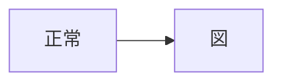

# `/learn` スキル Implementation Plan

> **For agentic workers:** REQUIRED SUB-SKILL: Use superpowers:executing-plans to implement this plan task-by-task（`~/.claude` は git 管理外のため worktree を使わずインライン実行）. Steps use checkbox (`- [ ]`) syntax for tracking.

**Goal:** Claude Code の作業内容から、自分が想起・言い直しで定着させるための教材ノートを Obsidian の専用 vault に生成する `/learn` スキルを作る。

**Architecture:** 単一の SKILL.md（hook なし・手動起動のみ）。Claude は材料収集・執筆・Mermaid 図・想起問題までを担い、予測／自分の言葉／3行メモ欄は空欄で残す。図は Obsidian 公式 CLI（`open` → `dev:dom` → `dev:screenshot`）で描画を自己検証する。

**Tech Stack:** Claude Code skill (Markdown)、Obsidian 1.12+ 公式 CLI、Mermaid

**Spec:** `docs/superpowers/specs/2026-09-28-learn-skill-design.md`

## Global Constraints

- トリガーは手動のみ。hook を追加しない
- vault: `C:\Users\<win-user>\Documents\Obsidian Vault\学習\`（WSL: `~/vault/学習/`）。`obsidian.json` を編集しない
- ノート名: `YYYY-MM-DD <テーマ>.md`、frontmatter は `source` / `created` / `tags: [learn]`
- 「答えを見る前に予測」「自分の言葉で説明」「確認したいこと（3行メモ）」の本文を Claude が埋めない
- 描画確認の修正ループは最大3回
- Gemini Notebook へのアップロードは自動化しない。教材に認証情報・個人情報を含めない
- スキルは WSL 側・Windows 側の両方に同一内容で配置する（同期は手動コピー。両側とも実ディレクトリ）
- Obsidian CLI 呼び出しには必ず `timeout` を付ける（`obsidian version` が 120 秒応答しなかった実績あり）

---

### Task 1: 前提作業と Obsidian CLI の実機確認（Windows 側）

CLI 仕様の未確定点（`path=` の解決基準、Mermaid の DOM セレクタ、描画エラー時の DOM、日本語 vault 名の受け渡し）をここで確定させる。Task 3 の SKILL.md はこの結果を書き込む。

**Files:**
- Create（検証後に削除）: `C:\Users\<win-user>\Documents\Obsidian Vault\学習\_cli-smoke.md`

**Interfaces:**
- Produces: `OBS_WIN`（Windows 側で動く CLI 呼び出し文字列）、`MERMAID_OK_SELECTOR`、`MERMAID_ERR_SELECTOR`、`SHOT_PATH_RULE`（`path=` が絶対パスを受け付けるか／vault 相対か）

- [ ] **Step 1: ユーザーに前提作業を依頼し、完了を待つ**
  1. Obsidian → Settings → General → 「Command line interface」を ON
  2. `C:\Users\<win-user>\Documents\Obsidian Vault\学習` フォルダを作成し、Obsidian で「フォルダを vault として開く」
  3. Claude Code（Windows 側）を再起動して PATH を反映

- [ ] **Step 2: CLI が応答するか確認**

Run: `timeout 20 obsidian help 2>&1 | head -30; echo EXIT=$?`
Expected: コマンド一覧が出る。アプリ起動ログのみで終わる／EXIT=124 の場合は Step 1 の設定を見直すようユーザーに報告して止まる（迂回しない）

- [ ] **Step 3: 検証用ノートを作成**

Write `C:\Users\<win-user>\Documents\Obsidian Vault\学習\_cli-smoke.md`:

````markdown
# cli smoke



```mermaid
flowchart LR
  A[壊れた --> 
```
````

- [ ] **Step 4: 日本語 vault 名でノートを開けるか確認**

Run: `timeout 20 obsidian vault=学習 open path=_cli-smoke.md 2>&1; echo EXIT=$?`
Expected: Obsidian で該当ノートが開く。失敗したら `vault="学習"` と引用符付きで再試行し、結果を記録

- [ ] **Step 5: Mermaid の DOM を確認しセレクタを確定**

Run:
```bash
timeout 20 obsidian vault=学習 dev:dom selector=".mermaid" total 2>&1
timeout 20 obsidian vault=学習 dev:dom selector=".mermaid svg" total 2>&1
timeout 20 obsidian vault=学習 dev:dom selector=".mermaid" all text 2>&1 | head -20
```
Expected: `.mermaid` が 2、正常図の `svg` が 1 以上。壊れた図のテキストにエラー文言（例: "Syntax error"）が出る。実際の値から `MERMAID_OK_SELECTOR` と `MERMAID_ERR_SELECTOR`（エラー要素のセレクタ or テキスト判定）を確定し記録する。Live Preview で描画されない場合は reading view への切替手段を調べ、ユーザーに報告して止まる

- [ ] **Step 6: スクリーンショットの保存先ルールを確定**

Run:
```bash
timeout 20 obsidian vault=学習 dev:screenshot path='C:\Users\<win-user>\AppData\Local\Temp\learn-smoke.png' 2>&1; ls -la /c/Users/<win-user>/AppData/Local/Temp/learn-smoke.png
```
Expected: PNG ができる → `SHOT_PATH_RULE=絶対パス可`。できない場合は `path=learn-smoke.png` で再試行し、生成場所（vault 直下か cwd か）を `ls` で特定して記録する

- [ ] **Step 7: 画像を Read して目視確認できることを確認**

Read `C:\Users\<win-user>\AppData\Local\Temp\learn-smoke.png`（または Step 6 で特定した場所）
Expected: 正常図が描画され、壊れた図がエラー表示になっている

- [ ] **Step 8: 後始末**

`_cli-smoke.md` と `learn-smoke.png` を削除（本タスクで作った検証用ファイルのみ）。確定した4値をユーザーに報告

---

### Task 2: WSL 側から Windows 側 CLI を呼べるか確認

**Interfaces:**
- Consumes: Task 1 の `OBS_WIN` とセレクタ
- Produces: `OBS_WSL`（WSL 側の呼び出し文字列）または「WSL 側は描画確認不可」の判定

- [ ] **Step 1: WSL から Obsidian.com を実行**

Run:
```bash
MSYS_NO_PATHCONV=1 wsl.exe -d Ubuntu -- zsh -c 'ls -la /mnt/c/Users/<win-user>/AppData/Local/Programs/Obsidian/ | command grep -i obsidian; timeout 20 /mnt/c/Users/<win-user>/AppData/Local/Programs/Obsidian/Obsidian.com help 2>&1 | head -10; echo EXIT=$?'
```
Expected: コマンド一覧が出る → `OBS_WSL=/mnt/c/Users/<win-user>/AppData/Local/Programs/Obsidian/Obsidian.com`。`Obsidian.com` が無い場合は `ls` の結果にある CLI 実体で再試行。応答しなければ「WSL 側は描画確認不可」と判定

- [ ] **Step 2: 応答した場合のみ、日本語 vault 名の受け渡しを確認**

Task 1 Step 3 と同じ `_cli-smoke.md` を一時作成し、`$OBS_WSL vault=学習 dev:dom selector="<MERMAID_OK_SELECTOR>" total` を WSL 側から実行（スクリプトを `\\wsl.localhost\Ubuntu\tmp\obs-smoke.sh` に書いて `MSYS_NO_PATHCONV=1 wsl.exe -d Ubuntu -- zsh /tmp/obs-smoke.sh`）。
Expected: Task 1 Step 5 と同じ件数。検証後に `_cli-smoke.md` を削除

---

### Task 3: SKILL.md 作成（WSL 側）

**Files:**
- Create: `~/.claude/skills/learn/SKILL.md`（Write は `\\wsl.localhost\Ubuntu\home\<user>\.claude\skills\learn\SKILL.md`）

**Interfaces:**
- Consumes: Task 1 の `MERMAID_OK_SELECTOR` / `MERMAID_ERR_SELECTOR` / `SHOT_PATH_RULE`、Task 2 の `OBS_WSL` 判定

- [ ] **Step 1: SKILL.md を書く**

下記の `<<...>>` 部分のみ Task 1・2 の確定値で置き換えて書く（それ以外は原文どおり）。

`````markdown
---
name: learn
description: |
  作業内容を自分が説明できる状態にする学習教材を Obsidian に作る時は必ずこのスキルを使う。
  「/learn」「教材にして」「学習ノート」「理解を定着させたい」「知識定着」と言われた時に起動。
  Claude は材料整理・図・想起問題までを担い、予測・言い直し・確認事項の欄は空欄で残す。
allowed-tools: Read, Write, Edit, Grep, Glob, Bash, AskUserQuestion
---

# Learn

Claude Code に任せた作業を、ユーザー自身が説明できる状態にするための教材ノートを作る。

## 原則: 摩擦を二種類に分ける

| 摩擦 | 担当 |
|---|---|
| 身につけたい能力から遠いもの（材料集め・整理・順序立て・図・問題作成） | Claude |
| 身につけたい能力そのもの（予測・想起・自分の言葉での言い直し・確認事項の整理） | ユーザー |

「答えを見る前に予測」「自分の言葉で説明」「確認したいこと（3行メモ）」の本文を Claude が書くことを禁止する。ユーザーに頼まれても書かない（書くと仕組みの意味が消える旨を伝える）。

## 保存先

| 実行環境 | vault の書き込み先 |
|---|---|
| Windows 版 claude（Git Bash） | `C:\Users\<win-user>\Documents\Obsidian Vault\学習\` |
| WSL 側 claude | `~/vault/学習/` |

ファイル名は `YYYY-MM-DD <テーマ>.md`。同名が既にあれば上書きせず、ユーザーに確認する。

## 手順

1. **テーマ決定**: 引数があればそれを使う。無ければ直近の作業から「任せきりで理解が薄そうな」候補を3件挙げ、AskUserQuestion で選ばせる
2. **材料収集**: 会話内容と作業ディレクトリのコードを読む（読み取りのみ）。範囲が広ければ `code-explore` に委譲し結論だけ受け取る
3. **執筆**（下記テンプレート）
   - 前提知識は「本題を理解するために先に知る必要がある順」に並べる
   - 主張には根拠を `file:line`（作業ディレクトリからの相対パス）で付ける
   - 用語は初出で一文定義する。未習の専門用語を説明のために増やさない
   - 「初心者向けに分かりやすく」の方向へ噛み砕かない（分かった気を助長する）
   - 認証情報・個人情報・接続文字列を含めない
4. **図**: 構造・流れ・依存関係を Mermaid で1〜3枚描く
5. **描画確認**（下記「描画確認」）。修正は最大3回。直らなければ図の該当箇所と症状を報告して止まる
6. **完了報告**: ノートのパス、図の検証結果（または省略理由）、Gemini Notebook へは手動でアップロードする旨を伝える

## テンプレート

````markdown
---
source: <作業ディレクトリの絶対パス>
created: YYYY-MM-DD
tags: [learn]
---
# <テーマ>

## 前提知識（順番に）

## 本題

## 答えを見る前に予測
<!-- 問いだけを書く。予測はユーザーが書く -->
- Q.

## 想起問題
1. 問題文
> [!answer]- 解答
> 解答本文

## 自分の言葉で説明
<!-- ユーザーが書く -->

## 確認したいこと（3行メモ）
1. ここまでは、こう理解している:
2. 根拠は、資料のこの部分:
3. ここを確かめたい:
````

想起問題は5問前後。「〜とは何か」の定義確認だけにせず、「なぜ〜なのか」「〜を変えると何が起きるか」を混ぜる。

## 描画確認

CLI 呼び出しには必ず `timeout 20` を付ける。

| 実行環境 | CLI |
|---|---|
| Windows 版 claude | `obsidian` |
| WSL 側 claude | <<OBS_WSL の値。不可なら「描画確認を省略し、完了報告に『WSL 側のため描画未確認』と明記する」>> |

1. 応答確認: `timeout 20 <CLI> help >/dev/null 2>&1` が失敗したら描画確認を省略し、理由を完了報告に書く
2. `timeout 20 <CLI> vault=学習 open path="<ファイル名>"`
3. `timeout 20 <CLI> vault=学習 dev:dom selector="<<MERMAID_OK_SELECTOR>>" total` の件数がノート内の Mermaid ブロック数と一致するか
4. <<MERMAID_ERR_SELECTOR による エラー検出コマンド>> でエラーが 0 件か
5. `timeout 20 <CLI> vault=学習 dev:screenshot path=<<SHOT_PATH_RULE に従ったパス>>` → 画像を Read して、ラベルの重なり・見切れ・意図と違う矢印が無いか目視確認し、確認後に画像を削除する
6. 問題があれば Mermaid を直して 2 に戻る
`````

- [ ] **Step 2: 置き換え漏れを確認**

Run: `MSYS_NO_PATHCONV=1 wsl.exe -d Ubuntu -- zsh -c 'command grep -n "<<" ~/.claude/skills/learn/SKILL.md; echo EXIT=$?'`
Expected: 出力なし・`EXIT=1`

---

### Task 4: Windows 側へ同期

**Files:**
- Create: `C:\Users\<win-user>\.claude\skills\learn\SKILL.md`

- [ ] **Step 1: コピー**

Run: `mkdir -p /c/Users/<win-user>/.claude/skills/learn && cp //wsl.localhost/Ubuntu/home/<user>/.claude/skills/learn/SKILL.md /c/Users/<win-user>/.claude/skills/learn/SKILL.md`

- [ ] **Step 2: 一致確認**

Run: `md5sum //wsl.localhost/Ubuntu/home/<user>/.claude/skills/learn/SKILL.md /c/Users/<win-user>/.claude/skills/learn/SKILL.md`
Expected: 2行のハッシュが一致

- [ ] **Step 3: スキルが認識されるか確認**

Claude Code を再起動（または新セッション）し、スキル一覧に `learn` が出ることをユーザーに確認してもらう

---

### Task 5: 実テーマで試作（E2E）

- [ ] **Step 1: 実プロジェクトで `/learn` を実行**

ユーザーが実プロジェクトの作業セッション内で `/learn`（引数なし）を実行し、候補提示 → 選択 → ノート生成まで通す

- [ ] **Step 2: 生成ノートをスペックと照合**

確認項目:
- ファイル名・frontmatter が Global Constraints どおり
- 「予測」は問いのみ、「自分の言葉で説明」は空欄、「3行メモ」は雛形のみ
- 主張に `file:line` 出典がある
- 解答が `> [!answer]-` で折り畳まれている（Obsidian 上で閉じて表示される）
- 描画確認が一巡した（または省略理由が報告された）
- 認証情報・個人情報を含まない

- [ ] **Step 3: 差異があれば SKILL.md を修正し、Task 4 の同期と一致確認をやり直す**
